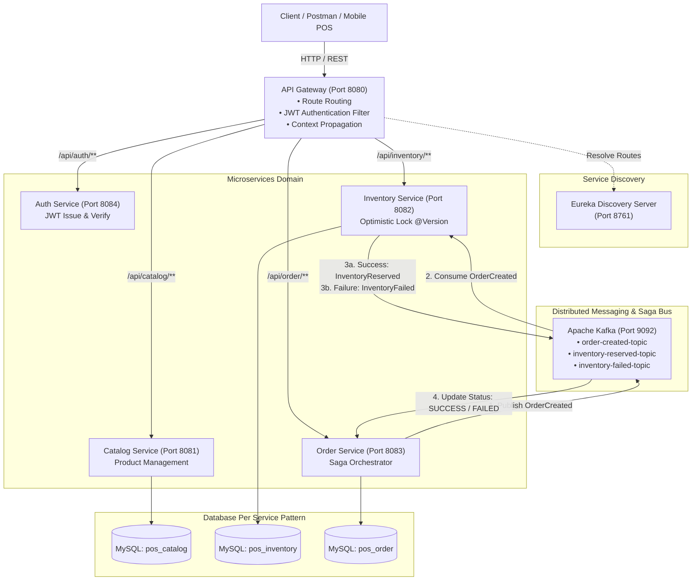
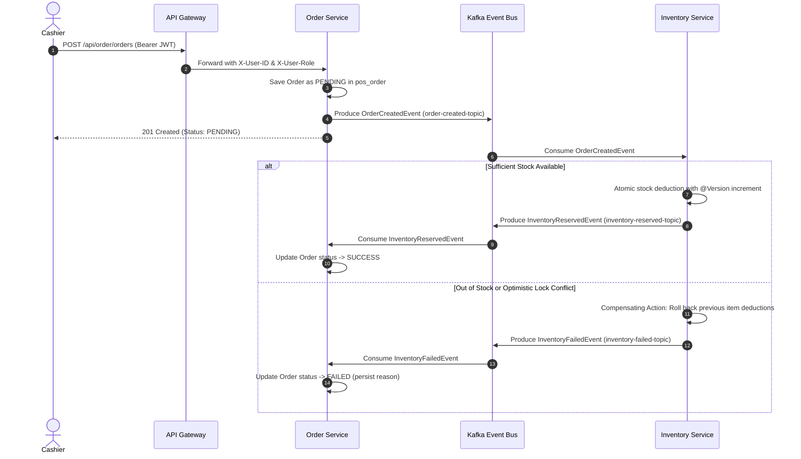

# Omni-Channel POS & Inventory System
**Enterprise Distributed Microservices Architecture**

[](https://www.oracle.com/java/)
[](https://spring.io/projects/spring-boot)
[](https://spring.io/projects/spring-cloud)
[](https://kafka.apache.org/)
[](https://www.mysql.com/)

An enterprise-grade, cloud-native Point of Sale (POS) and Multi-Branch Inventory backend built with **Java 21**, **Spring Boot 3.2**, **Spring Cloud (Eureka & Gateway)**, and **Apache Kafka**.

Designed using clean architecture, event-driven choreographies, and isolated database-per-service patterns, this platform solves distributed race conditions, guarantees eventual data consistency across high-throughput checkouts, and secures perimeter access via stateless HMAC-SHA256 JWT tokens.

---

## Architecture Overview



---

## Core Distributed Engineering Features

### 1. Distributed Transactions via Saga Choreography (Kafka)
In a database-per-service architecture, ACID transactions cannot span multiple databases without heavy two-phase commit (2PC) locks. We employ **Saga Pattern via Event Choreography**:



### 2. High-Concurrency Stock Protection (Optimistic Locking)
- **Problem**: Simultaneous multi-terminal checkouts for identical SKU risk overselling and negative inventory.
- **Solution**: The `Stock` entity implements JPA `@Version` optimistic locking.
- When concurrent updates encounter a stale version, Spring Data JPA throws `ObjectOptimisticLockingFailureException`. The `GlobalExceptionHandler` converts this to HTTP `409 CONFLICT` or triggers compensating rollbacks within the Saga processor.

### 3. Perimeter Security & Role-Based Access Control (RBAC)
- **API Gateway**: Non-blocking reactive `JwtAuthenticationFilter` (order -1) validates HMAC-SHA256 tokens, extracts `userId` and `roles`, and propagates verified `X-User-ID` and `X-User-Role` headers downstream.
- **Downstream Services**: Enforce fine-grained roles (`ROLE_ADMIN`, `ROLE_CASHIER`) without coupling to authentication databases.

---

## Tech Stack & Tooling

| Component | Technology | Description |
|---|---|---|
| **Language** | Java 21 LTS | Sealed Types, Records, Virtual Thread compatibility |
| **Framework** | Spring Boot 3.2.5 | Enterprise application backbone |
| **Service Discovery** | Netflix Eureka Server | Dynamic service registration & health heartbeat |
| **API Gateway** | Spring Cloud Gateway | Non-blocking reactive routing & perimeter security |
| **Messaging** | Apache Kafka 3.7 | Distributed event streaming for Saga choreography |
| **Databases** | MySQL 8.0 | Separate isolated physical schema per domain |
| **Persistence** | Spring Data JPA / Hibernate 6.4 | Clean repository abstraction & optimistic locking |
| **Security** | JJWT (io.jsonwebtoken 0.12.5) | Cryptographic HMAC-SHA256 token verification |
| **Testing** | `@EmbeddedKafka`, MockMvc, H2 | Zero-dependency integration testing suites |

---

## Service Catalog & Port Allocation

| Service | Port | Database / State | Responsibility |
|---|---|---|---|
| `eureka-server` | `8761` | — | Centralized service discovery registry |
| `api-gateway` | `8080` | — | Entry point, JWT authentication, downstream routing |
| `auth-service` | `8084` | In-Memory / Auth | User authentication, token issuance & verification |
| `catalog-service` | `8081` | `pos_catalog` | Product catalog, pricing, SKU classification |
| `inventory-service` | `8082` | `pos_inventory` | Multi-branch stock tracking, optimistic concurrency |
| `order-service` | `8083` | `pos_order` | Checkout handling, Saga transaction choreography |

---

## How to Run Locally

### 1. Prerequisites
- **JDK 21** (`java -version`)
- **MySQL 8.0** running on `localhost:3306` with schemas:
  ```sql
  CREATE DATABASE IF NOT EXISTS pos_catalog;
  CREATE DATABASE IF NOT EXISTS pos_inventory;
  CREATE DATABASE IF NOT EXISTS pos_order;
  ```
- **Apache Kafka** extracted at `C:\kafka`.

### 2. Start Infrastructure
**Terminal 1 — Zookeeper (Port 2181):**
```cmd
cd /d C:\kafka
bin\windows\zookeeper-server-start.bat config\zookeeper.properties
```

**Terminal 2 — Kafka Broker (Port 9092):**
```cmd
cd /d C:\kafka
bin\windows\kafka-server-start.bat config\server.properties
```

### 3. Start Microservices
Launch each module in order via terminal or VS Code Spring Boot Dashboard:
```bash
# 1. Service Registry
cd eureka-server && .\mvnw.cmd spring-boot:run

# 2. API Gateway
cd api-gateway && .\mvnw.cmd spring-boot:run

# 3. Auth Service
cd auth-service && .\mvnw.cmd spring-boot:run

# 4. Catalog Service
cd catalog-service && .\mvnw.cmd spring-boot:run

# 5. Inventory Service
cd inventory-service && .\mvnw.cmd spring-boot:run

# 6. Order Service
cd order-service && .\mvnw.cmd spring-boot:run
```

Eureka Dashboard: `http://localhost:8761`

---

## Automated Verification & Testing

Run all unit and integration test suites across all modules:
```bash
.\mvnw.cmd test
```

Tests run in-memory using H2 database and `@EmbeddedKafka` without needing live MySQL or external Kafka servers.
